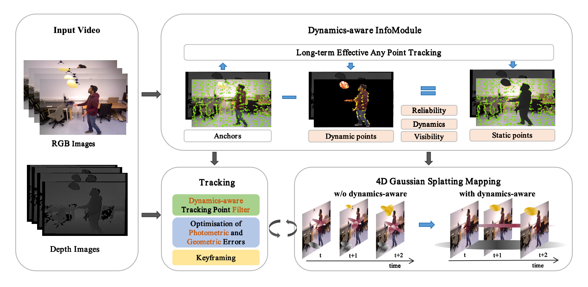

<p align="center">
  <h1 align="center">Embracing Dynamics: Dynamics-aware 4D Gaussian Splatting SLAM</h1>
</p>
<h3 align="center">IROS 2025</h3>


<!-- ### [Paper](https://arxiv.org/abs/2504.04844) | [Project Page](https://zhicongsun.github.io/d4dgs)-->
  <p align="center">
    <a href=""><strong>Zhicong Sun</strong></a>
    ,
    <a href=""><strong>Jinxing Hu*</strong></a>
    ,
    <a href=""><strong>Jacqueline Lo*</strong></a>
  </p>
  <p align="center">(* Corresponding Authors)</p>


[comment]: <> (  <h2 align="center">PAPER</h2>)
  <h3 align="center"><a href="https://arxiv.org/abs/2504.04844">Paper</a> | <a href="https://zhicongsun.github.io/d4dgs">Project Page</a></h3>
  <div align="center"></div>

<br>
<p align="center">
  <a href="">
    
  </a>
</p>
<p align="center">Overview of our D4DGS-SLAM.
</p>
<br>


# Released components

We have open-sourced the differentiable **4D Gaussian rasterizer** that
underpins D4DGS-SLAM. It extends the original 3DGS rasterizer with a
4D Gaussian map representation (per-Gaussian temporal center, temporal
scale, double-quaternion 4D rotation, 4D Spherical Harmonics) and a
MonoGS-style 6-DoF camera pose gradient.

- **[diff-4d-gaussian-rasterization](https://github.com/zhicongsun/diff-4d-gaussian-rasterization)**


# Acknowledgement

This work incorporates many open-source codes. We extend our gratitude to the authors of the software.
- [3D Gaussian Splatting](https://github.com/graphdeco-inria/gaussian-splatting)
- [Differential Gaussian Rasterization](https://github.com/graphdeco-inria/diff-gaussian-rasterization)
- [4D Gaussian Splatting](https://github.com/fudan-zvg/4d-gaussian-splatting)
- [Gaussian Splatting SLAM](https://github.com/muskie82/MonoGS)
- [LEAP-VO](https://github.com/chiaki530/leapvo)
- [SplaTAM](https://github.com/spla-tam/SplaTAM)


# License

D4DGS-SLAM is released under the MIT License (see [`LICENSE`](LICENSE)).

## Citation

If you find our paper and code useful, please cite us:

```bibtex
@inproceedings{sun2025embracing,
  title        = {Embracing dynamics: Dynamics-aware 4d gaussian splatting slam},
  author       = {Sun, Zhicong and Lo, Jacqueline and Hu, Jinxing},
  booktitle    = {2025 IEEE/RSJ International Conference on Intelligent Robots and Systems (IROS)},
  pages        = {5331--5338},
  year         = {2025},
  organization = {IEEE}
}
```
